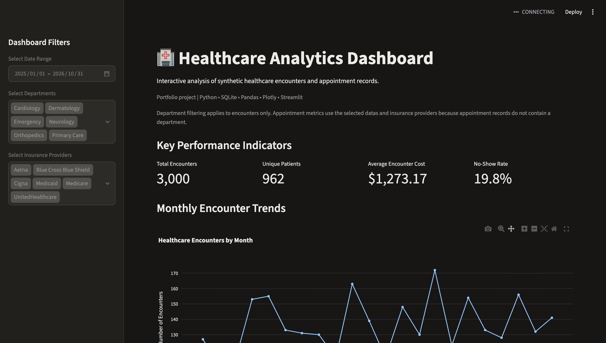
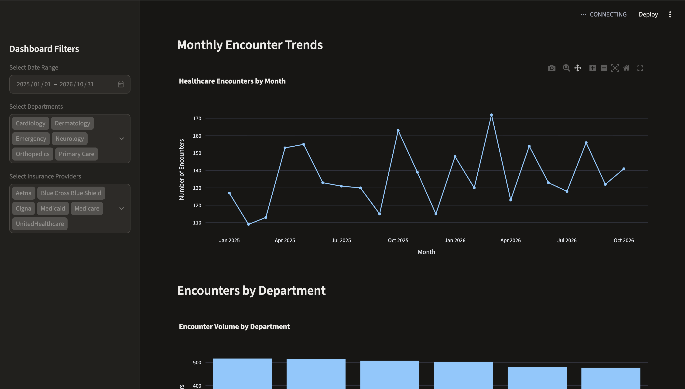
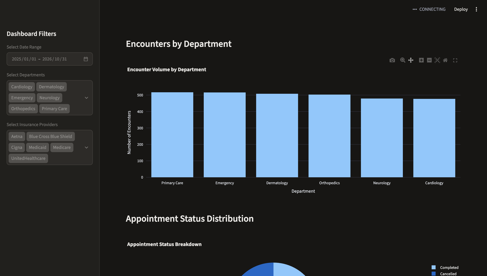
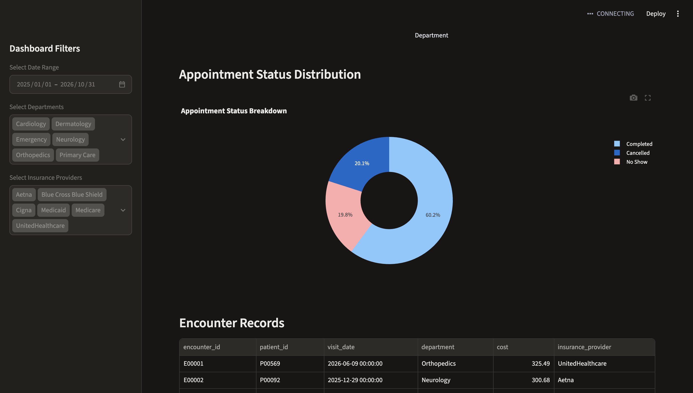
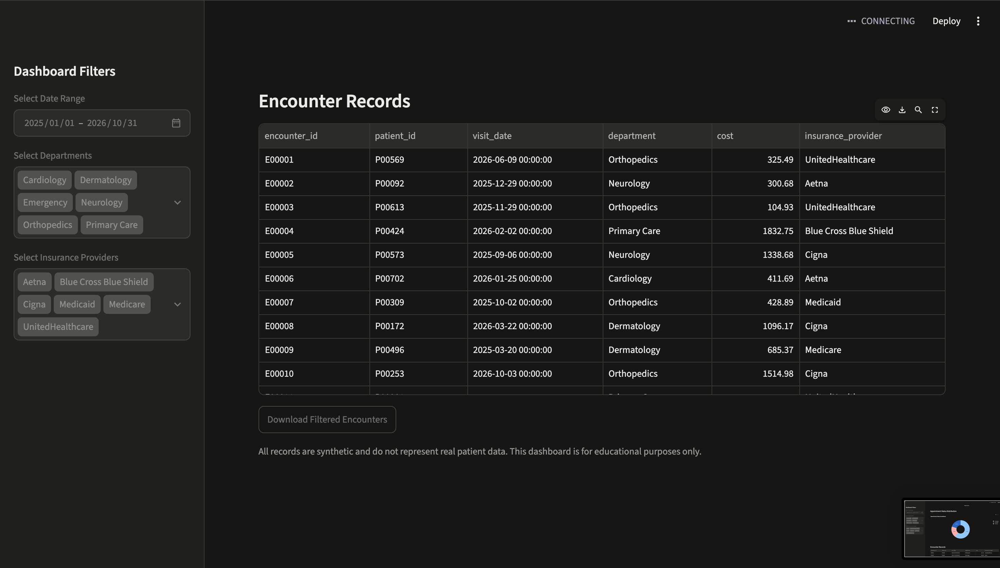

# Healthcare Analytics Dashboard

# Overview

An interactive healthcare analytics application developed using Python, SQLite, Pandas, Plotly, and Streamlit.

The project demonstrates healthcare data management, SQL integration, operational KPI analysis, interactive visualization, and automated software testing.

All patient, encounter, and appointment records are synthetically generated.

# Features

- Interactive dashboard displaying healthcare operational metrics
- Total encounters and unique patient counts
- Average encounter cost analysis
- Appointment no-show rate calculations
- Department and insurance provider filters
- Monthly encounter trends
- Appointment status visualizations
- Downloadable encounter reports
- Automated data quality and application logic tests

# Technologies

| Technology: Purpose
| Python: Application development
| SQLite: Relational database
| Pandas: Data processing and analysis
| Streamlit: Interactive dashboard
| Plotly: Data visualization
| Pytest: Automated testing
| GitHub Actions: Continuous integration

# Project Architecture

Synthetic Data Generator -> SQLite Database -> Python/Pandas Analytics -> Streamlit Dashboard

Automated testing is performed using Pytest and GitHub Actions.

# Dataset

The application generates 1,000 synthetic patient records, 3,000 encounters, and 2,000 appointments.

The dataset is fictional and does not contain protected health information (PHI).

Appointments and encounters are generated independently, and appointment metrics are not interpreted as encounter conversion rates.

# Installation

Clone the repository and navigate to the project directory.

Create and activate a Python virtual environment:

python3 -m venv .venv
source .venv/bin/activate

Install dependencies:

python -m pip install -r requirements.txt

Generate the synthetic database:

python scripts/generate_data.py

Run the dashboard:

python -m streamlit run app.py

# Testing

Run the automated test suite:

python -m pytest tests/ -v

The project includes tests for KPI calculations, filtering, database integrity, and data validation.

# Screenshots

## 1. Dashboard Overview
The main dashboard provides a centralized view of key healthcare performance indicators, patient encounters, and operational metrics

## 2. Monthly Encounter Trends
Visualize healthcare encounter trends over time to identify patterns in patient volume, service utilization, and operational demand

## 3. Encounters by Department
Displays the distribution of patient encounters across healthcare departments to support resource allocation, worklad assessment, and departmental performance analysis

## 4. Appointment Status Distribution
Appointment performance metrics to help identify scheduling trends, cancellations, and patient no-show rates

## 5. Encounter records
Table that provides a detailed, filterable view of individual encounter records, enabling granular data exploration and operational reporting.

# Future Improvements

- Integrate HL7 FHIR APIs
- Add PostgreSQL support
- Containerize the application using Docker
- Deploy to AWS
- Expand automated data quality monitoring

# Author

Alexander Pham

M.S. Bioinformatics — Johns Hopkins University

Healthcare professional transitioning into Healthcare IT and cloud engineering.